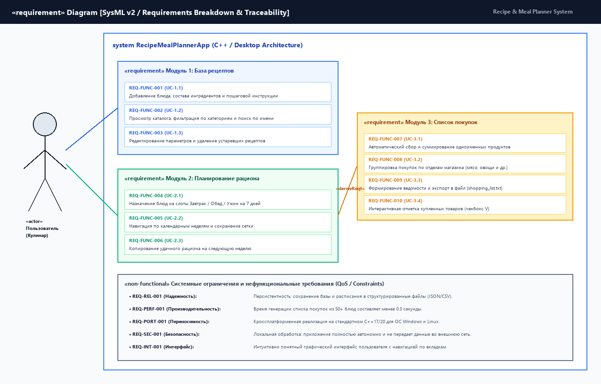
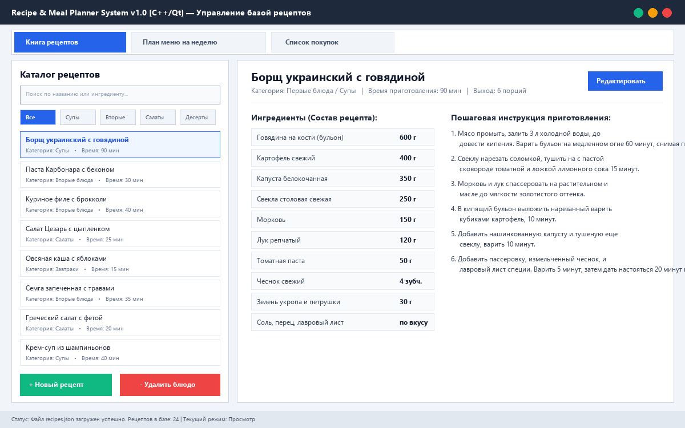
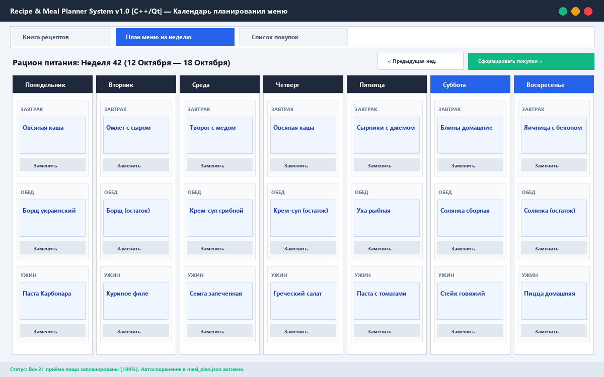
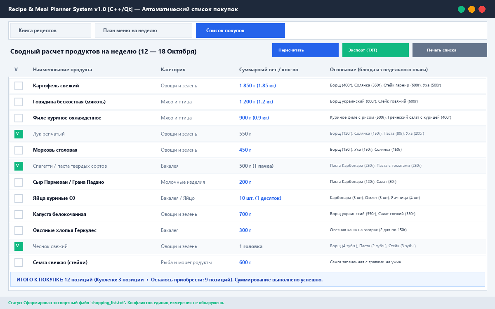

# Спецификация требований к ПО (SRS)

## Для проекта «Система рецептов и планирования меню» (Recipe & Meal Planner System)

**Версия:** 1.0  
**Статус:** Согласовано с Заказчиком  
**Подготовил:** Менеджер проекта / Системный аналитик А.В. Равковский (гр. 450503)  
**Организация:** БГУИР, Факультет компьютерных систем и сетей, Кафедра ЭВМ  
**Дата:** Октябрь 2026 г.  

---

## Оглавление

<!-- TOC -->
* [1. Введение](#1-введение)
  * [1.1 Назначение документа](#11-назначение-документа)
  * [1.2 Область применения продукта (Scope)](#12-область-применения-продукта-scope)
  * [1.3 Определения, акронимы и сокращения](#13-определения-акронимы-и-сокращения)
  * [1.4 Ссылки](#14-ссылки)
  * [1.5 Обзор документа](#15-обзор-документа)
* [2. Обзор продукта](#2-обзор-продукта)
  * [2.1 Перспектива продукта](#21-перспектива-продукта)
  * [2.2 Функции продукта](#22-функции-продукта)
  * [2.3 Ограничения продукта](#23-ограничения-продукта)
  * [2.4 Характеристики пользователей](#24-характеристики-пользователей)
  * [2.5 Допущения и зависимости](#25-допущения-и-зависимости)
  * [2.6 Распределение требований](#26-распределение-требований)
* [3. Требования](#3-требования)
  * [3.1 Внешние интерфейсы](#31-внешние-интерфейсы)
    * [3.1.1 Пользовательские интерфейсы (GUI)](#311-пользовательские-интерфейсы-gui)
    * [3.1.2 Аппаратные интерфейсы](#312-аппаратные-интерфейсы)
    * [3.1.3 Программные интерфейсы](#313-программные-интерфейсы)
  * [3.2 Функциональные требования](#32-функциональные-требования)
    * [3.2.1 Модуль 1: Управление рецептами](#321-модуль-1-управление-рецептами)
    * [3.2.2 Модуль 2: Планирование меню](#322-модуль-2-планирование-меню)
    * [3.2.3 Модуль 3: Генерация списка покупок](#323-модуль-3-генерация-списка-покупок)
  * [3.3 Качество обслуживания (QoS)](#33-качество-обслуживания-qos)
    * [3.3.1 Производительность](#331-производительность)
    * [3.3.2 Безопасность](#332-безопасность)
    * [3.3.3 Надёжность](#333-надёжность)
    * [3.3.4 Доступность](#334-доступность)
    * [3.3.5 Наблюдаемость](#335-наблюдаемость)
  * [3.4 Соответствие стандартам](#34-соответствие-стандартам)
  * [3.5 Проектирование и реализация](#35-проектирование-и-реализация)
    * [3.5.1 Установка и развёртывание](#351-установка-и-развёртывание)
    * [3.5.2 Сборка и поставка](#352-сборка-и-поставка)
    * [3.5.3 Распределение](#353-распределение)
    * [3.5.4 Сопровождаемость](#354-сопровождаемость)
    * [3.5.5 Повторное использование](#355-повторное-использование)
    * [3.5.6 Переносимость](#356-переносимость)
    * [3.5.7 Стоимость и сроки](#357-стоимость-и-сроки)
    * [3.5.8 Управление изменениями](#358-управление-изменениями)
* [4. Верификация](#4-верификация)
* [5. Приложения](#5-приложения)
<!-- TOC -->

---

## История изменений

| Имя автора | Дата | Причина изменений | Версия |
|:---|:---:|:---|:---:|
| А.В. Равковский | 07.10.2026 | Первоначальное формирование SRS по результатам интервью с Заказчиком | 0.1 |
| А.В. Равковский | 07.10.2026 | Добавлены мокапы интерфейса, диаграмма SysML v2, детализированы нефункциональные требования | 1.0 |

---

## 1. Введение

### 1.1 Назначение документа
Настоящий документ представляет собой Спецификацию требований к программному обеспечению (Software Requirements Specification, SRS) для десктопного программного комплекса **«Система рецептов и планирования меню»** (Recipe & Meal Planner System).

Цель документа — однозначно зафиксировать бизнес-цели, функциональные границы, архитектурные ограничения и критерии приемки разрабатываемого ПО на языке системной инженерии. Документ служит основным соглашением между **Заказчиком** и **Менеджером проекта / Разработчиком**, а также базой для последующего проектирования архитектуры (SDD), реализации на языке C++ и верификации (тестирования).

SRS определяет **ЧТО** система должна делать, сознательно абстрагируясь от деталей внутренней реализации отдельных алгоритмов.

### 1.2 Область применения продукта (Scope)
Продукт представляет собой автономное десктопное приложение для персональных компьютеров, призванное оптимизировать процессы домашней кулинарии, планирования питания и закупки продуктов.

**Бизнес-цели проекта:**
1. **Экономия времени:** сократить ежедневные временные затраты пользователя на принятие решений («что приготовить на обед/ужин?») за счет формирования наглядного недельного рациона.
2. **Оптимизация бюджета:** исключить импульсивные и избыточные покупки в продуктовых магазинах благодаря строгому автоматическому расчету требуемых ингредиентов.
3. **Удобство ведения кулинарной базы:** объединить разрозненные кулинарные рецепты в единый структурированный локальный каталог с быстрым поиском.

**Входит в границы системы (In-Scope):**
- Локальное хранение и ведение структурированной базы кулинарных рецептов (добавление, редактирование, удаление, просмотр).
- Подробное описание состава блюда: ингредиенты, весовые и объемные дозировки (граммы, миллилитры, штуки), пошаговое текстовое руководство.
- Интерактивный календарь-планировщик рациона на 7 дней недели с детализацией по приёмам пищи (Завтрак, Обед, Ужин).
- Автоматический сбор, агрегация и суммирование одноименных продуктов из всех выбранных в плане блюд.
- Формирование и экспорт итогового списка покупок в структурированный текстовый файл (TXT/CSV).
- Обеспечение сохранности данных (автосохранение в файлы JSON при закрытии приложения).

**НЕ входит в границы системы (Out-of-Scope):**
- Прямая интеграция с API торговых сетей и службами доставки еды.
- Облачная синхронизация между различными мобильными и стационарными устройствами (система строго локальная).
- Автоматический расчет химического состава и калорийности (КБЖУ) в базовой версии (отложено на будущие релизы).

### 1.3 Определения, акронимы и сокращения

| Термин / Акроним | Определение |
|:---|:---|
| **SRS** | Software Requirements Specification — спецификация требований к ПО. |
| **GUI** | Graphical User Interface — графический интерфейс пользователя. |
| **SysML v2** | Systems Modeling Language v2 — язык системного моделирования второго поколения. |
| **Рецепт (Recipe)** | Структурированная сущность данных, содержащая название, категорию, время приготовления, список ингредиентов и пошаговую инструкцию. |
| **Рацион (Meal Plan)** | Сетка приемов пищи на календарную неделю, сопоставляющая временные слоты (Завтрак, Обед, Ужин) конкретным рецептам. |
| **Список покупок** | Сводная ведомость продуктов, полученная в результате дедупликации и суммирования ингредиентов всех блюд из рациона. |
| **Персистентность** | Способность программы сохранять внутреннее состояние данных в энергонезависимой памяти (на диске). |

### 1.4 Ссылки
- **ISO/IEC/IEEE 29148:2018** — Systems and software engineering — Life cycle processes — Requirements engineering.
- **IEEE 830-1998** — Recommended Practice for Software Requirements Specifications.
- **СТП 01-2017** — Стандарт предприятия. Дипломные проекты, курсовые работы и отчеты по лабораторным работам. Правила оформления. Минск: БГУИР, 2017.

### 1.5 Обзор документа
Документ состоит из 5 разделов:
- *Раздел 1* вводит контекст и описывает границы проекта.
- *Раздел 2* содержит высокоуровневый обзор продукта, портрет целевой аудитории и системные ограничения.
- *Раздел 3* включает детализированную спецификацию требований (внешние интерфейсы, функциональные и нефункциональные требования с уникальными ID).
- *Раздел 4* представляет матрицу верификации требований.
- *Раздел 5* содержит ссылки на графические материалы и мокапы.

---

## 2. Обзор продукта

### 2.1 Перспектива продукта
«Система рецептов и планирования меню» разрабатывается как самостоятельное настольное приложение, функционирующее без обязательного подключения к глобальной сети Интернет. Продукт заменяет разрозненные бумажные кулинарные книги, заметки на смартфонах и электронные таблицы Excel специализированным инструментом с высокой эргономикой.

Архитектурная схема взаимодействия актора с системой и декомпозиция функциональных пакетов требований представлена на рисунке 2.1.

  
*Рисунок 2.1 — Диаграмма декомпозиции и связности требований (SysML v2 / Use Case View)*

### 2.2 Функции продукта
Система предоставляет пользователю следующий комплекс возможностей:
1. **Каталогизация блюд:** ведение картотеки рецептов с гибкой классификацией (первые, вторые блюда, салаты, десерты).
2. **Поиск и фильтрация:** мгновенная фильтрация блюд по категории и контекстный поиск по подстроке названия или ингредиента.
3. **Недельное планирование:** визуальное распределение блюд по дням недели (Пн–Вс) и приёмам пищи (Завтрак, Обед, Ужин).
4. **Консолидация закупок:** автоматический сбор всех необходимых компонентов рациона с математическим суммированием однотипных единиц (например, объединение картофеля для супа и гарнира).
5. **Экспорт и отслеживание:** выгрузка списка покупок в файл и интерактивная маркировка купленных товаров.

### 2.3 Ограничения продукта
1. **Технологический стек:** приложение должно быть разработано на языке **C++** (стандарт не ниже C++17) с использованием кроссплатформенного фреймворка GUI (Qt 6 / Qt 5).
2. **Формат хранения:** персистентность должна быть реализована на базе локальных файлов структурированного формата (**JSON** или CSV) без необходимости установки внешних СУБД (PostgreSQL/MySQL).
3. **Операционная система:** гарантированная поддержка ОС семейств Microsoft Windows (10/11 x64) и Linux (Ubuntu 22.04 LTS и выше).

### 2.4 Характеристики пользователей
Целевая аудитория делится на две ключевые категории пользователей:
1. **Домохозяйки и кулинары-любители:** пользователи, готовящие на семью, ценящие разнообразие меню и стремящиеся систематизировать накопленные рецепты.
2. **Студенты и работающие специалисты:** пользователи с жестким дефицитом свободного времени и фиксированным бюджетом, стремящиеся планировать питание заранее и закупать продукты строго раз в неделю без лишних затрат.
*Требования к квалификации:* базовые навыки работы с персональным компьютером (работа с мышью, клавиатурой, оконными элементами).

### 2.5 Допущения и зависимости
- Предполагается, что на рабочей машине пользователя установлена файловая система с поддержкой кодировки UTF-8.
- Разрешение экрана пользователя составляет не менее 1280×720 пикселей.
- Пользователь имеет права на чтение и запись в рабочую директорию программы для сохранения файлов базы данных.

### 2.6 Распределение требований
- **Итерация 1 (Базовый релиз, текущая ЛР):** Реализация локальной базы рецептов, календаря питания на неделю, алгоритма консолидации покупок и экспорта в TXT.
- **Итерация 2 (Перспективный релиз):** Добавление калькулятора пищевой ценности (КБЖУ), поддержка печати на принтере и учет остатков продуктов в домашнем холодильнике.

---

## 3. Требования

### 3.1 Внешние интерфейсы

#### 3.1.1 Пользовательские интерфейсы (GUI)

- **ID:** `REQ-INT-001`
- **Title:** Организация главного окна приложения
- **Statement:** Главное окно системы должно предоставлять вкладки верхнего уровня для беспрепятственного переключения между разделами: «Книга рецептов», «План меню на неделю» и «Список покупок».
- **Rationale:** Вкладочная навигация минимизирует количество модальных окон и обеспечивает предсказуемый пользовательский опыт.
- **Verification Method:** Inspection, Demonstration.

- **ID:** `REQ-INT-002`
- **Title:** Графический интерфейс каталога рецептов
- **Statement:** Экран рецептов должен содержать левую панель поиска со списком всех блюд и фильтрами категорий, а также правую информационную панель с детальной карточкой выбранного рецепта (ингредиенты и пошаговые инструкции).
- **Rationale:** Позволяет одновременно видеть весь каталог и изучать конкретное блюдо без дополнительных переходов.
- **Verification Method:** Demonstration.

  
*Рисунок 3.1 — Графический интерфейс каталога и просмотра рецепта*

- **ID:** `REQ-INT-003`
- **Title:** Графический интерфейс недельного календаря-планировщика
- **Statement:** Интерфейс планировщика меню должен представлять собой матрицу из 7 колонок (дни недели с понедельника по воскресенье), в каждой из которых выделены отдельные визуальные блоки под «Завтрак», «Обед» и «Ужин» с кнопками назначения и замены блюда.
- **Rationale:** Календарная сетка дает наглядное представление о рационе всей недели на одном экране.
- **Verification Method:** Demonstration.

  
*Рисунок 3.2 — Графический интерфейс календаря-планировщика на неделю*

- **ID:** `REQ-INT-004`
- **Title:** Графический интерфейс сводного списка покупок
- **Statement:** Экран списка покупок должен представлять интерактивную таблицу, содержащую столбцы: «Отметка покупки (чекбокс)», «Наименование продукта», «Категория отдела», «Суммарное количество» и «Основание (список блюд, где используется ингредиент)».
- **Rationale:** Обеспечивает трассируемость каждого купленного продукта к соответствующему блюду в плане питания.
- **Verification Method:** Demonstration.

  
*Рисунок 3.3 — Графический интерфейс автоматического списка покупок*

#### 3.1.2 Аппаратные интерфейсы
- Специализированные аппаратные интерфейсы отсутствуют. Ввод осуществляется через стандартные манипуляторы «мышь» и клавиатуру.

#### 3.1.3 Программные интерфейсы
- **Файловая подсистема:** взаимодействие с дисковым хранилищем посредством стандартных потоков C++ (`std::filesystem`, `std::fstream`) для чтения/записи файлов `recipes.json`, `meal_plan.json` и `shopping_list.txt`.

---

### 3.2 Функциональные требования

#### 3.2.1 Модуль 1: Управление рецептами

- **ID:** `REQ-FUNC-001`
- **Title:** Добавление нового кулинарного рецепта (UC-1.1)
- **Statement:** Система должна предоставлять диалоговую форму для создания нового рецепта, требующую ввода названия блюда, выбора категории (суп, второе, салат, десерт и др.), времени приготовления, динамического списка ингредиентов (наименование, числовое количество, единица измерения) и текста пошаговой инструкции.
- **Rationale:** Основная функция наполнения пользовательской базы знаний.
- **Acceptance Criteria:** Рецепт сохраняется в коллекции в памяти и немедленно отображается в общем списке. Попытка сохранить рецепт без названия или без единого ингредиента блокируется с выдачей понятного предупреждения.
- **Verification Method:** Test.

- **ID:** `REQ-FUNC-002`
- **Title:** Поиск и фильтрация рецептов (UC-1.2)
- **Statement:** Система должна выполнять фильтрацию каталога рецептов в реальном времени при вводе поисковой строки пользователем (поиск по вхождению подстроки в название блюда или состав ингредиентов) и при выборе категории блюд.
- **Rationale:** Быстрое нахождение нужного блюда при разрастании базы до десятков и сотен позиций.
- **Acceptance Criteria:** Время фильтрации списка из 500 элементов при вводе символа не превышает 50 мс.
- **Verification Method:** Test.

- **ID:** `REQ-FUNC-003`
- **Title:** Редактирование и удаление рецепта (UC-1.3)
- **Statement:** Система должна позволять изменять состав и инструкцию любого существующего рецепта, а также безвозвратно удалять выбранный рецепт после запроса подтверждения у пользователя.
- **Rationale:** Поддержание базы данных в актуальном состоянии.
- **Acceptance Criteria:** При удалении рецепта, назначенного в текущем рационе, пользователю выводится диалог предупреждения с предложением очистить слот или отменить удаление.
- **Verification Method:** Test.

#### 3.2.2 Модуль 2: Планирование меню

- **ID:** `REQ-FUNC-004`
- **Title:** Формирование недельного рациона (UC-2.1)
- **Statement:** Пользователь должен иметь возможность сопоставить любому из 21 слота недели (7 дней × 3 приема пищи: завтрак, обед, ужин) конкретное блюдо из базы рецептов через выпадающий список или диалог выбора.
- **Rationale:** Реализация базовой бизнес-цели предварительного планирования питания.
- **Acceptance Criteria:** Назначенное блюдо отображается в карточке слота. Допускается назначение одного и того же блюда на несколько приемов (например, суп на обед в понедельник и вторник).
- **Verification Method:** Test.

- **ID:** `REQ-FUNC-005`
- **Title:** Очистка и замена слотов питания
- **Statement:** Система должна обеспечивать возможность быстрой очистки любого отдельного слота, а также полной очистки расписания на выбранную неделю нажатием одной функциональной кнопки.
- **Rationale:** Удобство перепланирования рациона при изменении планов пользователя.
- **Acceptance Criteria:** Слот переходит в состояние «Не заполнено», обновляя индикатор заполненности плана.
- **Verification Method:** Demonstration.

#### 3.2.3 Модуль 3: Генерация списка покупок

- **ID:** `REQ-FUNC-006`
- **Title:** Автоматический сводный расчёт ингредиентов (UC-3.1)
- **Statement:** По нажатию кнопки «Сформировать покупки» система должна просканировать все заполненные слоты меню на текущую неделю, извлечь списки необходимых ингредиентов, сгруппировать совпадающие по названию и единицам измерения продукты и суммировать их числовые объёмы.
- **Rationale:** Исключение рутинного ручного подсчета продуктов и предотвращение дублирования покупок.
- **Acceptance Criteria:** Если ингредиент «Картофель» (г) присутствует в трех разных блюдах в объемах 400г, 350г и 600г, итоговый список покупок должен содержать единую строку «Картофель» с суммарным количеством 1350г.
- **Verification Method:** Test.

- **ID:** `REQ-FUNC-007`
- **Title:** Интерактивное управление закупками (чекбоксы)
- **Statement:** Пользователь должен иметь возможность отмечать купленные позиции непосредственно в интерфейсе. Отмеченные элементы должны визуально выделяться (перечеркивание, изменение цвета) и уменьшать счетчик «Осталось купить».
- **Rationale:** Использование приложения в качестве интерактивного чек-листа во время закупки.
- **Acceptance Criteria:** Статус отметки сохраняется в течение рабочей сессии.
- **Verification Method:** Demonstration.

- **ID:** `REQ-FUNC-008`
- **Title:** Экспорт списка покупок в файл
- **Statement:** Система должна предоставлять функцию сохранения сгенерированного списка покупок в виде структурированного текстового документа (`shopping_list.txt`) с разбиением по отделам магазина.
- **Rationale:** Возможность распечатать список на бумаге или переслать его на мобильное устройство через мессенджеры.
- **Acceptance Criteria:** Файл успешно формируется в кодировке UTF-8 и содержит удобочитаемый список наименований с граммовками.
- **Verification Method:** Test.

---

### 3.3 Качество обслуживания (QoS)

#### 3.3.1 Производительность
- **ID:** `REQ-PERF-001`
- **Title:** Время агрегации списка покупок
- **Statement:** Полный цикл сканирования меню из 21 приема пищи и суммирования до 100 уникальных ингредиентов не должен превышать 300 мс на типовом ПК (процессор частотой от 2.0 ГГц).
- **Verification Method:** Test.

#### 3.3.2 Безопасность
- **ID:** `REQ-SEC-001`
- **Title:** Локальная конфиденциальность данных
- **Statement:** Приложение не должно инициировать сетевые соединения и отправлять кулинарные или пользовательские предпочтения во внешнюю сеть. Все данные хранятся строго локально на диске пользователя.
- **Verification Method:** Inspection.

#### 3.3.3 Надёжность
- **ID:** `REQ-REL-001`
- **Title:** Атомарность сохранения и персистентность
- **Statement:** Сохранение структуры базы рецептов и плана меню в файлы JSON должно выполняться по алгоритму безопасной записи (запись во временный файл с последующим атомарным переименованием) во избежание повреждения базы при сбое питания.
- **Verification Method:** Test.

#### 3.3.4 Доступность
- **ID:** `REQ-AVAIL-001`
- **Title:** Автономность работы
- **Statement:** Приложение должно быть готово к немедленному запуску и выполнению всех функциональных задач без зависимости от интернет-соединения или внешних облачных серверов (готовность 100% офлайн).
- **Verification Method:** Demonstration.

#### 3.3.5 Наблюдаемость
- **ID:** `REQ-OBS-001`
- **Title:** Диагностика файловых ошибок
- **Statement:** В случае отсутствия прав доступа к файлу или повреждения синтаксиса JSON система должна отображать понятное модальное сообщение пользователю и записывать детали исключения в локальный лог `app.log`.
- **Verification Method:** Test.

---

### 3.4 Соответствие стандартам
- Документация требований сформирована в строгом соответствии с требованиями стандарта **ISO/IEC/IEEE 29148:2018** и методическими указаниями кафедры ЭВМ БГУИР.

---

### 3.5 Проектирование и реализация

#### 3.5.1 Установка и развёртывание
- **ID:** `REQ-INST-001`
- **Statement:** Программа должна поставляться в виде автономного переносимого (portable) каталога или единого исполняемого файла, не требующего прав администратора ОС для запуска.

#### 3.5.2 Сборка и поставка
- **ID:** `REQ-BUILD-001`
- **Statement:** Сборка проекта должна производиться с помощью кроссплатформенной системы автоматизации сборки **CMake** (минимальная версия 3.16).

#### 3.5.3 Распределение
- Приложение является монолитным однопользовательским десктопным клиентом.

#### 3.5.4 Сопровождаемость
- Исходный код C++ должен быть разделен по архитектурному паттерну MVC (Model-View-Controller) либо MVVM для изолирования бизнес-логики расчета покупок от графического интерфейса.

#### 3.5.5 Повторное использование
- Модуль суммирования ингредиентов (`ShoppingAggregator`) должен быть оформлен в виде независимого C++ класса, свободного от графических зависимостей, пригодного для повторного использования в консольных утилитах.

#### 3.5.6 Переносимость
- **ID:** `REQ-PORT-001`
- **Statement:** Исходный код должен компилироваться компиляторами MSVC (Visual Studio 2022), GCC (версия 11+) и Clang без модификации кодовой базы.

#### 3.5.7 Стоимость и сроки
- Разработка ведется силами студенческой команды в рамках академического семестра. Срок реализации MVP первой версии — ноябрь 2026 г.

#### 3.5.8 Управление изменениями
- Все изменения требований и архитектурных решений подлежат регистрации в журнале изменений (Revision History) и рецензированию в репозитории через механизм Pull Requests.

---

## 4. Верификация

Матрица верификации требований определяет способ подтверждения соответствия реализации заявленным спецификациям:

| ID требования | Наименование требования | Метод верификации | Артефакт проверки | Статус |
|:---|:---|:---:|:---|:---:|
| `REQ-INT-001` | Организация вкладок главного окна | Demonstration | Визуальный прогон GUI | Запланирован |
| `REQ-INT-002` | Каталог и просмотр рецепта | Demonstration | Проверка макета экрана | Запланирован |
| `REQ-INT-003` | Сетка календаря-планировщика | Demonstration | Проверка макета экрана | Запланирован |
| `REQ-INT-004` | Таблица списка покупок | Demonstration | Проверка макета экрана | Запланирован |
| `REQ-FUNC-001` | Добавление нового рецепта | Test | Модульный тест `TestAddRecipe` | Запланирован |
| `REQ-FUNC-002` | Поиск и фильтрация рецептов | Test | Модульный тест `TestFilterSearch` | Запланирован |
| `REQ-FUNC-003` | Удаление и валидация рецептов | Test | Модульный тест `TestDeleteRecipe` | Запланирован |
| `REQ-FUNC-004` | Заполнение слотов рациона | Test | Модульный тест `TestPlanAssignment` | Запланирован |
| `REQ-FUNC-006` | Агрегация и суммирование покупок | Test | Модульный тест `TestAggregatorSum` | Запланирован |
| `REQ-FUNC-008` | Экспорт в текстовый файл | Test | Модульный тест `TestExportFile` | Запланирован |
| `REQ-PERF-001` | Производительность расчета (< 300мс) | Test | Бенчмарк `BenchmarkAggregation` | Запланирован |
| `REQ-REL-001` | Атомарное сохранение в JSON | Test | Тест восстановления целостности | Запланирован |
| `REQ-PORT-001` | Сборка под Windows и Linux | Test | CI Сборка (GitHub Actions) | Запланирован |

---

## 5. Приложения

В данном разделе представлены ссылки на графические артефакты проектной документации, созданные на этапе формулирования требований:

1. **Диаграмма требований SysML v2 / Иерархия Use Cases:** [`images/sysml_requirements_diagram.png`](images/sysml_requirements_diagram.png)
2. **Мокап графического интерфейса — Каталог и рецепты:** [`images/gui_mockup_recipes.png`](images/gui_mockup_recipes.png)
3. **Мокап графического интерфейса — Недельный рацион питания:** [`images/gui_mockup_planner.png`](images/gui_mockup_planner.png)
4. **Мокап графического интерфейса — Сводный список покупок:** [`images/gui_mockup_shopping_list.png`](images/gui_mockup_shopping_list.png)
